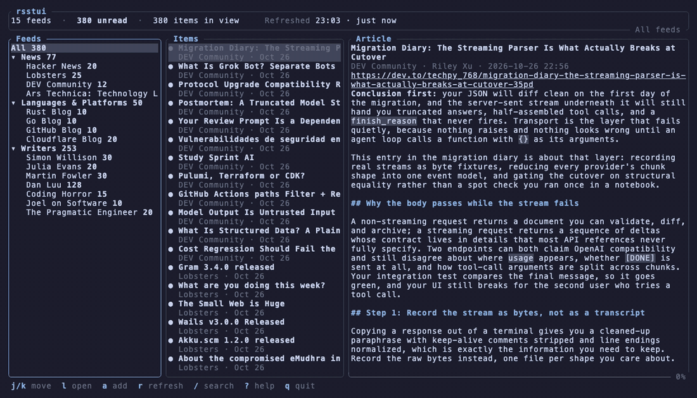

# rsstui

A terminal RSS/Atom reader with inline images, built on `ratatui`.



<sub>The demo uses the halfblocks image fallback; kitty, iTerm2 and sixel terminals draw
real images. Re-record it with `docs/make-demo.sh` (needs [vhs](https://github.com/charmbracelet/vhs)).</sub>

The header box shows the feed (or folder) in view, with its tags and when it was
last refreshed. Feeds can be grouped into folders and tagged, and the Feeds pane
can be filtered by tag.

## Installation

### macOS (Homebrew)

Homebrew on macOS (Apple Silicon and Intel) is the supported way to install, with prebuilt binaries:

```sh
brew tap simoncoulton/rsstui https://github.com/simoncoulton/rsstui
brew install rsstui
```

### Arch Linux and other distributions

There is no package for Arch or its derivatives yet. Build from source with a recent
[Rust toolchain](https://rustup.rs) (1.90 or newer):

```sh
git clone https://github.com/simoncoulton/rsstui
cd rsstui
cargo install --path .       # or: cargo run --release
```


## Files

Everything is YAML, in `~/.config/rsstui/` (also on macOS):

| File | |
| --- | --- |
| `config.yml` | Settings and feeds. Hand-editable; rsstui edits it in place and keeps your comments (only the `feeds:` block is regenerated when you add, remove, tag or move a feed). Unknown keys are errors. Press `E` to edit it in `$VISUAL` / `$EDITOR`; it reloads when the editor exits. |
| `themes/*.yml` | One file per colour theme. A file for each built-in is written on first run; edit them or add your own. They are re-read whenever you press `T`. |
| `state.yml` | Which items you have read and which folders are collapsed. |

### config.yml

The config starts with no feeds: press `a` in the app to add some (or list them in the file).

```yaml
images: true              # draw each article's lead image
refresh_minutes: 0        # auto-refresh all feeds (0 = off)
image_protocol: auto      # or halfblocks, to skip the terminal probe
theme: default            # the name of a file in themes/
transparent_background: true
layout: horizontal      # or vertical: items above the article (press v)

feeds:
  - name: Hacker News
    url: https://hnrss.org/frontpage
    folder: News          # optional
    tags: [aggregator, news]   # optional
```

Folders are just the `folder:` names, shown in order of first use; feeds without
one are listed after them.

### Themes

`themes/nord.yml`:

```yaml
bg: "#2e3440"
fg: "#d8dee9"
muted: "#616e88"
accent: "#88c0d0"
border: "#4c566a"
selection_bg: "#434c5e"
success: "#a3be8c"
info: "#81a1c1"
warning: "#ebcb8b"
error: "#bf616a"
special: "#b48ead"
```

Colours are `#rrggbb`, an ANSI name (`red`, `darkgray`, `reset`) or `0`-`255`. Add
`base: <built-in>` to fill in anything you remove. A new file is a new theme named
after the file. Built-ins: default (your terminal's colours), tokyo-night,
catppuccin-frappe / mocha / macchiato / latte, dracula, one-dark, gruvbox-dark,
nord, solarized-dark, rose-pine, monokai, github-dark, everforest, kanagawa.
Themes can also be defined under `themes:` in `config.yml`.

## Keys

Press `?` in the app for the same list.

| Key | Action |
| --- | --- |
| `j` `k` `↑` `↓` | Move / scroll |
| `h` `l` `←` `→` | Change pane (in Feeds: close / open a folder) |
| `g` `G` | Top / bottom |
| `Enter` | Open item; toggle a folder |
| `Esc` | Back; clear search / tag filter; cancel dialogs |
| `a` | Add a feed (joins the folder under the cursor; errors show in the dialog) |
| `d` | Remove the selected feed (asks first) |
| `F` | Move the feed to a folder, or a new one |
| `t` | Edit the feed's tags (`Space` toggles, type to add, `Del` removes a tag everywhere) |
| `f` | Filter the Feeds pane by tag (`Esc` in Feeds clears it) |
| `Space` | Open / close a folder |
| `r` / `R` | Refresh the feed or folder / all feeds |
| `/` | Search items by title, author or body (`Enter` keeps, `Esc` clears) |
| `m` / `M` | Toggle read / mark all read |
| `u` | Unread only |
| `o` | Open in browser |
| `n` / `p` | Next / previous article |
| `z` | Zoom the article pane |
| `v` | Toggle the Items/Article layout: side by side or stacked (saved) |
| `i` | Toggle images |
| `T` | Theme picker: moves preview live, `b` toggles transparency, `Enter` saves, `Esc` restores |
| `E` | Edit the config file |
| `?` | Help |
| `q` | Quit |

## Development

`cargo fmt --all --check`, `cargo clippy --all-targets -- -D warnings` and
`cargo test` should all pass. See `AGENTS.md` for the conventions.
